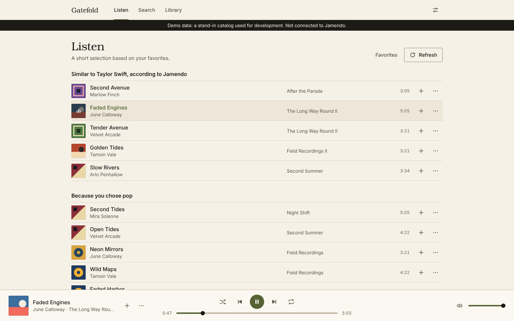
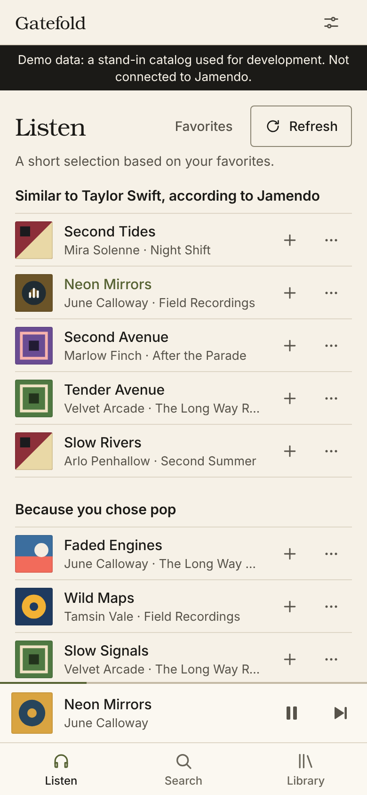
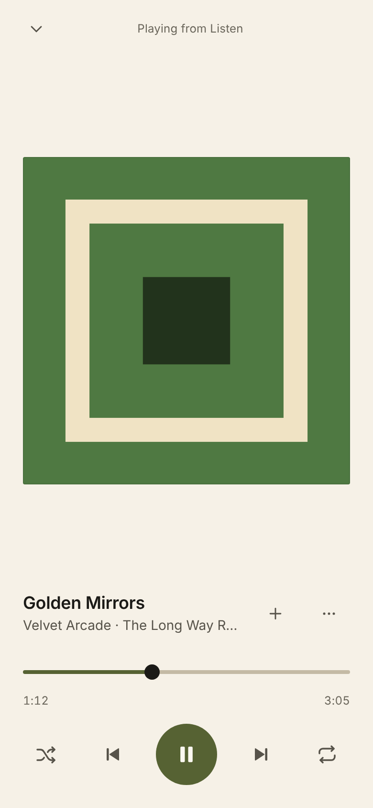

# Gatefold

My own little ad-free music player. It plays full songs, lets me search, keeps my playlists, and suggests new music based on what I actually listen to. No ads, no subscription, no "upgrade to premium" pop-ups. It's the parts of a streaming app I actually use, minus the part that kept driving me crazy.

**Try it here:** https://YOUR-USERNAME.github.io/gatefold/

(The first time, you'll need a free key from Jamendo. It takes about five minutes, and the steps are further down.)



*These screenshots come from my test setup, which uses a made-up catalog, so the band names and covers are invented.*

## Why I made this

I have music on pretty much any time I'm at the gym or studying. The thing that kept breaking my concentration wasn't the music. It was the ads. You're in the middle of a set, or finally getting into a problem, and suddenly someone's trying to sell you something. Then it happens again twenty minutes later.

At some point I got annoyed enough to wonder how hard it would be to make my own player. I'd never really built a website or an app before, so this turned into a crash course in how they actually work.

## What I figured out along the way

The first surprise: an app being able to *find* a song is a completely different thing from being able to *play* it. Lots of music services will happily give you a song's title, artist and cover art. Very few will hand over the actual audio.

So I went through the usual suspects. Spotify does let developers build their own players, but only with Premium, both for the person building the app and for the person listening, so "free and no ads" was off the table. YouTube has basically every song ever, but its developer rules say an app can't block YouTube's ads, and the video has to stay on screen. Apple Music needs a subscription plus a paid developer membership on top.

Then I found Jamendo: a free catalog of around half a million songs by independent artists who share their music under Creative Commons licenses. Full songs, no ads, and free for personal, non-commercial projects like this one.

The catch is that my actual favorites (Don Toliver, Taylor Swift, Katy Perry) aren't on it. I couldn't find any legit way to play major-label music for free without ads, so I had to pick, and I picked no ads. My favorites still count for something, though: the app uses them as a starting point and asks Jamendo for independent songs in a similar style. When it does that, it says so, so I always know why a song showed up. The upside is that it's a built-in excuse to find artists I'd never have come across otherwise.

## What it does

I kept it to three screens, on purpose.

**Listen** is a short list of recommended songs, up to fifteen, split into a few small groups. Each group has a one-line reason, like "Because you play jazz and funk" or "Similar to Taylor Swift, according to Jamendo." There's a Refresh button for when I want something different. No endless feed.

**Search** looks up songs by title, artist or album. Tap a song to play it (the rest of the results line up behind it), or hit + to drop it into a playlist.

**Library** holds my playlists. I can make, rename and delete them, drag songs into a different order, and play them straight through or shuffled.

The player stays at the bottom the whole time, so the music keeps going while I jump between screens. It has the usual controls: play and pause, skip, seek, volume, shuffle and repeat. On my phone it shrinks to a mini player above the tabs and opens up full screen when I tap it. It also remembers where I left off, and on a laptop the space bar pauses it.

<p>
  
  
</p>

## How the recommendations work (no magic)

I wanted to actually understand this part, so it's simple on purpose. The app quietly keeps track of three things:

- songs I listen to for at least 30 seconds or half the song, whichever comes first
- songs I save to a playlist, which count extra
- songs I skip in the first few seconds, so those don't get suggested again for a while

Each of those adds weight to that song's artist and to its tags (genre, mood, instruments). Older listens slowly count for less. When I open Listen, it asks Jamendo for songs similar to what I've been playing and songs with my top genres, then filters out anything I've heard recently or already saved.

Before there's any history, it starts from a few artists or genres I pick. There's also deliberately no stats page. The history only exists to choose songs, and I didn't want another app turning my listening into a scoreboard.

## The look

I wanted it to feel like flipping through a record collection, not a slot machine. So it's warm ivory paper, near-black text and one olive green accent, and the album art brings the color. Headings use TeX Gyre Bonum, a Bookman-style typeface with a very 70s-record-sleeve feel. Everything else is in Inter so it stays easy to read. There are only three small animations, and each one shows you something: a button press registering, a song sliding into its new spot in a playlist, and the phone player opening up. They switch off if your device is set to reduce motion.

The name comes from gatefold sleeves, the album covers that open up like a book.

## How it got built

I built this with Claude (Anthropic's AI) as a coding partner. I started from a detailed brief of what I wanted: three screens, real playback, no fluff, no ads, no stats. The big calls were mine, like which music source to go with, what to give up to keep it ad-free, and how it should look and feel. Claude did the research legwork, wrote and tested the code, and explained the tradeoffs along the way so I could decide.

A few things I found interesting about how it works:

- The whole app is one file, `index.html`. There's no server, no database and no account. You can literally double-click it.
- Playlists and settings are saved in your own browser, not anywhere online.
- The environment it was built in couldn't reach Jamendo, so it was tested against a fake stand-in catalog full of made-up bands and generated test tones. About 290 automated checks click through the app in a real browser at five screen sizes, from a big monitor down to a small phone.
- It's hosted for free on GitHub Pages, which is how it gets a web address I can open on my phone.

## Using it yourself

1. Get a free key from Jamendo. Sign up at [devportal.jamendo.com](https://devportal.jamendo.com), create an "application" (any name works), and copy its **Client ID**.
2. Open the app, either from the link at the top or by downloading `index.html` and double-clicking it.
3. Paste the Client ID in and hit Connect.
4. Open Settings (the little slider icon, top right) and press **Check the connection**. It runs the real requests and tells you in plain words whether everything works, including whether songs come through full-length.
5. Pick a few artists or genres you like, and go.

Your key and playlists stay in your own browser. Nothing gets uploaded anywhere.

## Stuff to know

**Your playlists live in your browser.** A different browser or device starts out empty, and clearing your browsing data wipes them. Settings has "Save backup file" and "Restore from file" for exactly this, so it's worth saving a backup every so often. On an iPhone, add the site to your Home Screen. Safari can clear a website's saved data if you haven't visited it in a week of using Safari, and Home Screen apps don't count toward that.

**It's independent music only.** Mainstream artists aren't on Jamendo, so this sits next to the big services rather than replacing them.

**It depends on Jamendo.** If Jamendo ever changes its rules or shuts off its API, search and playback stop working.

**Lock-screen playback isn't fully tested yet.** Whether music carries on to the next song with the phone locked is up to the phone's browser.

**It streams.** There's no offline mode, because Jamendo's terms don't allow apps built for offline listening, so it uses data when you're not on Wi-Fi.

## If you want to poke at the code

The source is in `src/`, split up by job. `catalog.js` talks to Jamendo, `player.js` handles playback, `playlists.js` saves playlists, `taste.js` does the recommendations, and the `view-*.js` files draw the three screens. To rebuild `index.html` after changing something, run these from the project folder:

```
node tools/make-fonts.js
node tools/build.js
```

The tests need Node, ffmpeg and Playwright (`npm install playwright`, then `npx playwright install chromium`). Start the fake catalog servers, then run the checks:

```
bash dev/make-audio.sh
PORT=8787 node dev/mock-jamendo.js &
PORT=8788 LONG=1 node dev/mock-jamendo.js &
PORT=8789 NO_CORS=1 node dev/mock-jamendo.js &
PORT=8790 node dev/static-server.js &
node tests/e2e.js
```

## Credits

Music comes from [Jamendo](https://www.jamendo.com) and the independent artists who share their work there. Every song in the app links back to its page on Jamendo. This is a personal, non-commercial project and isn't affiliated with or endorsed by Jamendo.

Fonts: TeX Gyre Bonum (GUST Font License) and Inter (SIL Open Font License 1.1). Their licenses are in `src/fonts/`.
